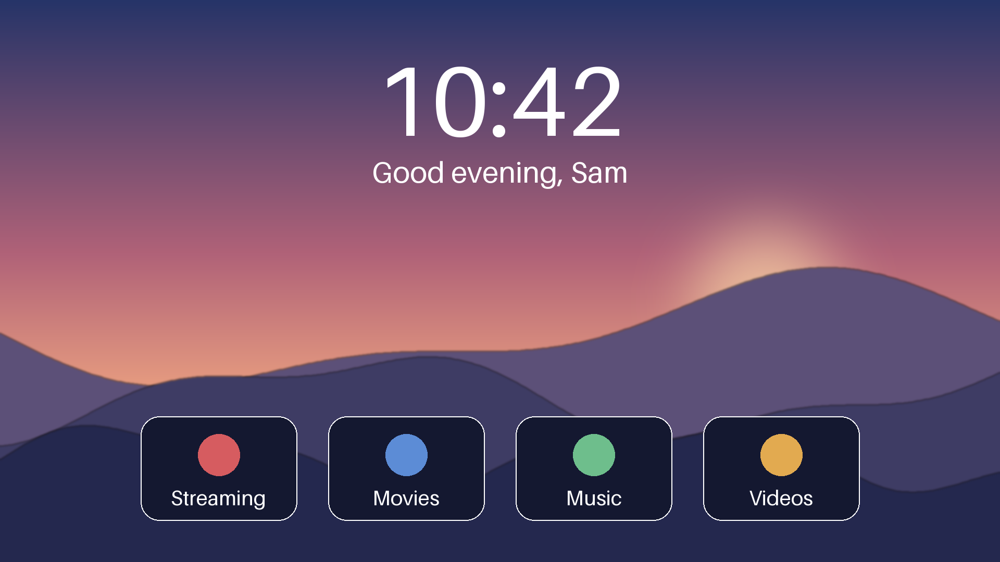

# android-tv-custom

An open-source way to take back your Android TV: switch off the ads and preinstalled junk, and replace the home screen with your own photos, a small clock, your name and your favourite apps.



> **Status:** v1.0, in testing on a TCL TV. [Undo everything](#undo-it) at any time.

## Quick start
1. Open [`PROMPT.md`](PROMPT.md) in this repo.
2. Copy all of it.
3. Paste it into your AI coding tool (Claude Code, Cursor, Codex, Antigravity or similar) and follow along.

You don't need to know how to code. The AI does the work on your TV step by step, asks you before anything that depends on your choices, and never touches the parts that make your TV a TV. It takes about an hour. Check [Before you start](#before-you-start) first.

## What it does, and what it doesn't
**It does**
- **Switch off the junk and ads.** Ad services, trackers and preinstalled apps are disabled from your computer over your home Wi-Fi. Every step can be undone.
- **Give you your own home screen.** Your photos as the background, plus a clock, your name and up to eight app shortcuts. Every other app, including ones you install later from the Play Store, is in the App library at the end of Home.

**It doesn't**
- **Touch your streaming apps.** Netflix, Prime Video, Disney+, YouTube and the rest are never switched off.
- **Remove ads inside streaming apps.** Those ads come from the apps themselves (for example Prime Video's ad tier), so they stay.
- **Delete anything.** Apps are only switched off, never uninstalled.
- **Touch the parts that make your TV a TV.** HDMI inputs, the tuner, the remote, Bluetooth, the keyboard, the Play Store and Settings are left alone.
- **Upload your photos or settings.** They stay on your computer and your TV.

On Google TV, the "Continue watching" and recommendation rows belong to the old home screen, so they go with it. Each app's own "continue watching" still works.

## Tested on
| TV | Android / Google TV | Status | Date |
|---|---|---|---|
| TCL, R51MT05 platform (Settings shows no model name on this firmware) | Google TV, Android 11 | Works: 16 packages off; new home screen in redirect mode (Google TV's home flashes for a moment, then yours); held volume, app buttons, Input and Settings work; survives restart and standby | 2026-11-20 |

Works on Android TV and Google TV sets. It does not work on Samsung, LG, Roku or Fire TV. Rows are added by pull requests from the ["Tested on my TV" issue form](https://github.com/grassurntech/android-tv-custom/issues/new?template=tested-on-my-tv.yml), so if it worked (or didn't) on yours, please tell us.

## Before you start
Your AI tool checks each of these for you and walks you through anything missing. It's quicker if they're ready.

**Your TV**
- [ ] An Android TV or Google TV (Samsung, LG, Roku and Fire TV are not supported)
- [ ] On the same Wi-Fi network as your computer
- [ ] Developer mode and debugging switched on (see [Turn on developer mode](#turn-on-developer-mode-on-your-tv))

**Your computer** (Mac, Windows or Linux)
- [ ] An AI coding tool that can run terminal commands: Claude Code, Cursor, Codex, Antigravity or similar
- [ ] **Docker Desktop, installed and running.** This builds the home-screen app on your computer (see [Install Docker](#install-docker))
- [ ] Git and Python 3 (on a Mac, the first time you need them it offers to install them for you)
- [ ] At least 5 GB of free disk space

**Ready to hand**
- [ ] A folder of photos you'd like on your home screen. They stay on your computer and your TV only.
- [ ] The name you want shown, and your favourite apps (1 to 8). Photos can wait: the home screen works without them

### Install Docker
Docker builds the home-screen app inside a sealed box on your computer, so you don't need to install Java or Android developer tools. You only do this once.

**Mac**
1. Download **Docker Desktop** from [docker.com/products/docker-desktop](https://www.docker.com/products/docker-desktop/). Pick **Apple chip** or **Intel chip** to match your Mac ( → About This Mac).
2. Open the downloaded file and drag Docker into Applications.
3. Open Docker from Applications, enter your Mac password when asked, and accept the terms.
4. **Apple chip Macs only:** in Docker, open Settings → General and turn on **"Use Rosetta for x86_64/amd64 emulation on Apple Silicon"**, then click Apply & restart.
5. Wait until Docker's whale icon in the menu bar says **Docker Desktop is running**.

**Windows** (Windows 10 or 11, 64-bit)
1. Download **Docker Desktop for Windows** from [docker.com/products/docker-desktop](https://www.docker.com/products/docker-desktop/).
2. Run the installer and keep **"Use WSL 2"** ticked. Restart your PC if it asks.
3. Open Docker Desktop, accept the terms, and wait until it says **Engine running**.

**Linux:** install Docker Engine for your distribution by following [docs.docker.com/engine/install](https://docs.docker.com/engine/install/).

Leave Docker open while your AI tool works. The first build takes about 10 minutes (up to 20 on a slower computer) and downloads about 1.5 GB. Later builds take under a minute.

> Docker Desktop is free for personal use, education, open-source projects and small businesses (under 250 employees and under $10M annual revenue). Larger organisations need a paid plan.

### Turn on developer mode on your TV
1. **Google TV:** Settings → System → About → select **Android TV OS build** 7 times.
   **Older Android TV:** Settings → Device Preferences → About → select **Build** 7 times.
2. Go back to the previous menu, then open **Developer options**.
3. Turn on **USB debugging**, and **Network debugging** or **Wireless debugging** if your TV shows it.
4. When your AI tool connects, an **"Allow debugging?"** box appears on the TV. Select **Allow**.

Your AI tool switches debugging off again when it's finished, so your TV doesn't stay open on the network.

### If your AI tool can't reach the TV
- **You can't find the TV's IP address.** In Settings → Network & Internet, select the Wi-Fi network you're connected to (the name, not the switch), or try Settings → System → About → Status. You need the address with four numbers and dots, like `192.168.1.23` or `10.0.0.42`. An address starting with `fe80:` is a different kind and won't work. Still nothing? Look for the TV under "connected devices" in your router's app, or ask your AI tool to find it: on a Mac or Linux it can look up the TV by the name it uses for casting.
- **There's only "USB debugging", no "Network debugging".** On many Google TV sets (TCL included), USB debugging also opens the network connection. After switching it on, restart the TV from Settings → System → Restart. Pressing the remote's power button only puts it to sleep.
- **Mac: the AI tool says "No route to host".** macOS is blocking it from your home network. Open System Settings → Privacy & Security → Local Network, switch your AI app on, then quit it fully (Cmd+Q) and reopen it. If it still fails, open the Terminal app and run these two lines from this project's folder, then leave Terminal open while your AI tool works:
  ```bash
  tools/platform-tools/adb kill-server
  tools/platform-tools/adb connect <your TV's IP>:5555
  ```
  Allow Terminal if macOS asks, and select **Allow** on the TV.
- **Mac: installing the home screen says "No route to host" even from Terminal.** The installer runs on Python, and Python from python.org relaunches itself as its own small app, which macOS blocks separately from Terminal. Switch **Python** on under System Settings → Privacy & Security → Local Network, then run the install and `push-theme` from Terminal (they are the two steps that use cleanyourtv's own connection, so the TV asks to "Allow debugging?" once more).
- **Google TV: the new home screen installs but Home still opens Google TV.** Some sets (TCL Google TV included) keep Google TV's launcher as Home while it is switched on. Install with `HOME_KEY_SERVICE=1 STOCK_HOME_REDIRECT=1`: Google TV's launcher stays on, and a small helper sends the Home button to your new screen. The setup wizard is never switched off: on these sets it owns the saved Wi-Fi.

## Undo it
One command puts your TV back as it was. Turn debugging back on first (see [Turn on developer mode](#turn-on-developer-mode-on-your-tv)), open a terminal in this project's folder, then run:

- **Mac or Linux:** `bash scripts/restore.sh`
- **Windows (PowerShell):** `powershell -NoProfile -ExecutionPolicy Bypass -File scripts\restore.ps1`

It switches everything we turned off back on, and puts your TV's own home screen back. Our home-screen app stays installed but switched off. To undo only one part, add `--home-only` (just the home screen) or `--packages-only` (just the apps) to the command.

To bring back a single app without a computer: Settings → Apps → See all apps → the app → Enable.

## Fork it, run it, change it
This project is built for forking. Your photos, name and TV details live only in your local `.env` and content folders, which git ignores, so your fork never exposes them.

```bash
git clone https://github.com/<you>/android-tv-custom.git
cd android-tv-custom
cp .env.example .env        # Windows: copy .env.example .env. Then fill in your own values
git config core.hooksPath scripts/hooks   # turns on the secret guardrail
```

## Built on
The home-screen app and the core debloat tools come from [cleanyourtv](https://github.com/Gathin23/cleanyourtv) (MIT), pinned to a tested version. This project adds a stricter safety layer, a beginner-proof prompt, and the photos-and-name home-screen theme.

## Contributing and security
- [CONTRIBUTING.md](CONTRIBUTING.md): how to propose changes
- [docs/SECURITY.md](docs/SECURITY.md): secrets policy and how to report a vulnerability

## License
[MIT](LICENSE). Use it, fork it, change it, share it. Just keep the copyright notice.

## Disclaimer
This is an independent community project. It is not affiliated with or endorsed by TCL, Google or any TV manufacturer. Changing system apps on your TV is at your own risk. Always keep the restore steps handy.
